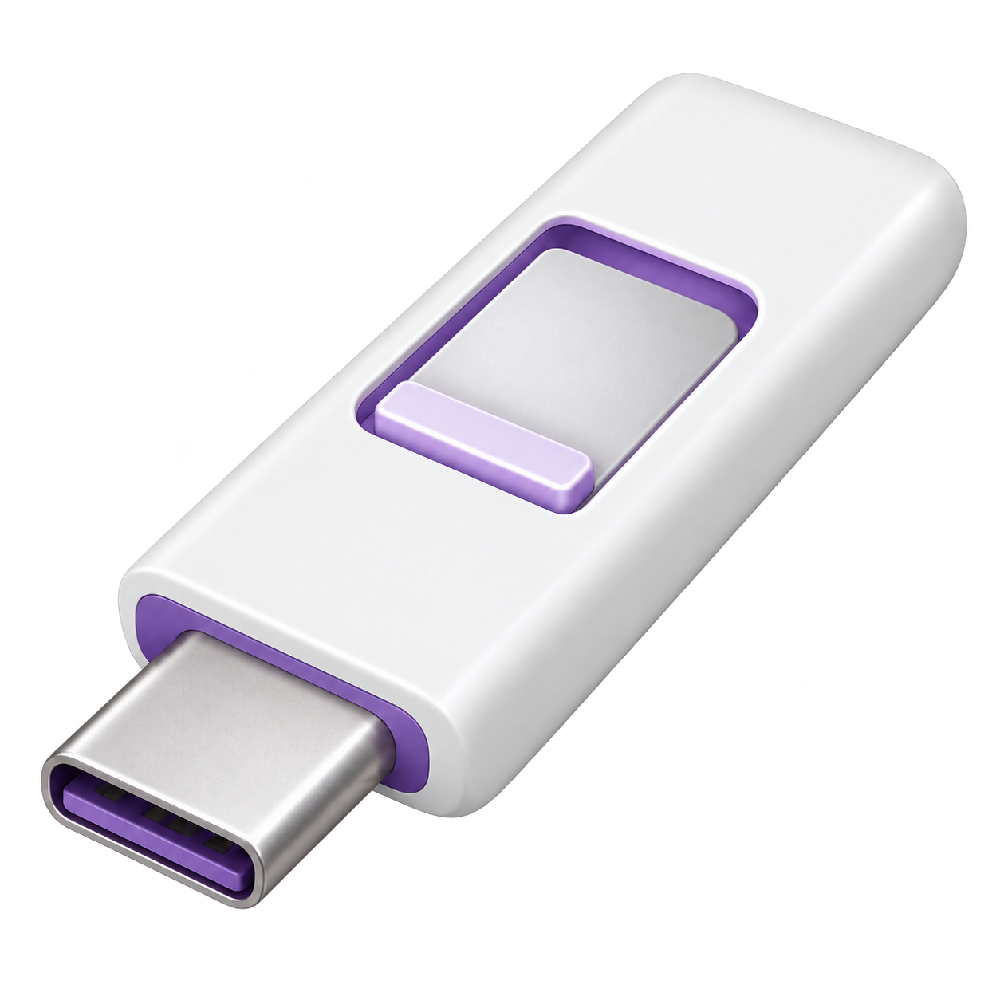

<p align="center">
  
</p>

<h1 align="center">Mufus</h1>
<p align="center"><strong>A native macOS utility for creating USB installation media.</strong></p>
<p align="center">Write Linux disk images · Prepare Windows UEFI installers · Format USB drives</p>

<p align="center">
  
  
  <a href="LICENSE.txt"></a>
</p>

Mufus is an open-source USB creator built with Swift and SwiftUI. It provides three full-width tabs for writing a disk image, preparing a Windows installation USB, and formatting an external USB drive. It uses native macOS disk tools and checks the data it writes.

**Status:** early release. Automated tests use disposable disk images; physical USB boot tests and Apple notarization are still outstanding. Mufus is an independent implementation, not an official Rufus port or a complete replacement for every Rufus feature.

## Download

Download the **universal DMG** from [GitHub Releases](https://github.com/ITCleric/Mufus/releases). Open it and drag **Mufus** into **Applications**.

The app is ad-hoc signed, without an Apple Developer ID or notarization. macOS may block the first launch on another Mac. Builds target macOS 12+, but the current validation was performed on macOS 26.4.1 on Apple Silicon, with the Intel executable also run under Rosetta. The interface is currently in Dutch.

## Features

| Tab | Supported workflow |
| --- | --- |
| **Image schrijven** | Write hybrid Linux ISOs and raw IMG, DD or BIN images, followed by SHA-256 readback verification. |
| **Windows USB** | Prepare FAT32 Windows 10/11 UEFI installation media, with MBR or GPT. Automatically split oversized `install.wim` files using bundled wimlib. |
| **Formatteren** | Format external USB media as FAT32, exFAT or Mac OS Extended, with MBR or GPT. |

- Native Apple Silicon and Intel executables in one app.
- Explicit drive-erasure confirmation and macOS administrator authorization.
- Production writes restricted to whole, physical, writable external USB disks.
- Drive identity checked again before destructive operations.
- Refuses to erase the volume holding the source image, Mufus, or the running macOS installation.
- SHA-256 image checksums, copy verification, logs, and safe ejection after success.
- A resizable interface with full-width tabs and the supplied purple USB artwork.

**Writing or formatting erases the selected USB drive.** Windows media targets a compatible UEFI computer; this does not make Windows boot natively on Apple Silicon.

## What is not supported yet?

Windows To Go, FreeDOS, legacy BIOS bootloader installation, NTFS/ext/ReFS formatting, Linux persistence, bad-block testing, ISO downloads, and Windows 11/OOBE customization are not implemented. Compressed DMGs, non-hybrid optical ISOs in raw-write mode, and FAT32 files larger than 4 GiB other than `sources/install.wim` are rejected.

## Build from source

Requires macOS and Xcode Command Line Tools. The repository includes the universal `wimlib-imagex` executable and its matching source archive and license notices.

```sh
git clone https://github.com/ITCleric/Mufus.git
cd Mufus
bash build.sh
```

The resulting app is `build/Mufus.app`. The build script compiles both architectures, signs locally, and runs the self-tests on the host architecture.

To rebuild the bundled wimlib executable, run `bash build-wimlib.sh` before building the app. To regenerate the macOS icon from the original artwork, run `python3 Resources/make-icon.py`.

## Validation

```sh
bash test.sh
```

The test runner builds the app, runs unit and regression checks, then exercises the actual job executor against a newly created temporary disk image. It covers all six format combinations, raw writing with readback, and Windows ISO copying with and without WIM splitting. The WIM test uses reduced size thresholds so it can exercise splitting without allocating a real 4+ GiB archive.

The disposable-image permission exists only in a separately compiled test executable. It is excluded from the shipping app. Tests never erase a physical USB drive. Bootability, real USB-controller behavior, and older macOS versions require separate hardware testing. See [the validation report](docs/VALIDATION.md).

## Project background

The initial investigation used REA 6.5.0 and Ghidra 12.1.4 to inspect a supplied Rufus 4.15 executable, including an unpacked UPX copy. Public Rufus source was consulted to understand Windows-specific operations. Mufus implements its own macOS workflows with `diskutil`, `hdiutil`, POSIX I/O, CryptoKit and wimlib. See [ANALYSE.txt](ANALYSE.txt) for the bounded analysis findings.

## Contributing

Bug reports, compatibility results, and contributions are welcome. Please include your macOS version, processor architecture, selected workflow, image type, and the relevant Mufus log. Remove personal paths or other private information before posting logs. See [CONTRIBUTING.md](CONTRIBUTING.md).

## License

Mufus source is available under [GPL-3.0-or-later](LICENSE.txt). wimlib is distributed with its [upstream notices](Resources/Licenses/wimlib-COPYING.txt), license texts, and corresponding source in `tools/wimlib-1.14.5.tar.gz`.
